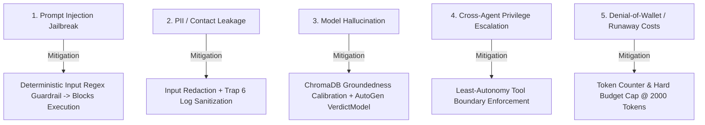

# ⚖️ Naukri.com Domain Support Agent — Risk Classification & Regulatory Assessment

**Author**: Naukri.com Domain Support Architecture Team  
**System**: Multi-Agent Candidate Support & Recruitment Inquiry Platform  
**Target Domain**: Recruitment, Candidate Evaluation & HR Operations  
**Risk Classification Tier**: **Medium-to-High Risk**

---

## 📌 1. Formal Risk Classification Justification

> [!IMPORTANT]
> **Executive Regulatory Assessment Statement**:  
> The Naukri.com Domain Support Agent is formally categorized as a **Medium-to-High Risk AI system** in accordance with the **European Union Artificial Intelligence Act (Regulation 2024/1689, Annex III, Section 4: *Employment, workers management and access to self-employment*)**, the **Indian Digital Personal Data Protection Act (DPDP Act 2023)**, and the **NIST AI Risk Management Framework (AI RMF 1.0)**. 
> 
> The system directly processes confidential candidate identifiers, employment histories, recruitment screening timelines, background check verification findings, and sensitive compensation bands (including executive salary caps under POL-005). Because automated agent decisions directly determine priority managerial escalation recommendations, interview rescheduling eligibility, and candidate communication, any model hallucination, unauthorized disclosure, or ungrounded policy assertion poses significant risks of economic harm, candidate disenfranchisement, and regulatory non-compliance. Consequently, this risk tier mandates mandatory technical controls: strict Least-Autonomy tool isolation, automated PII redaction for Indian mobile numbers and emails, calibrated vector groundedness thresholds ($0.4000$), hard token budget caps, and an independent AutoGen policy compliance review stage prior to candidate transmission.

---

## 🏛️ 2. Regulatory Alignment Matrix

| Regulatory Standard | Legal Article / Annex | Statutory Requirement | Implementation in System |
| :--- | :--- | :--- | :--- |
| **EU AI Act** | Annex III, Section 4(a) | Systems intended to be used for recruitment or selection of natural persons are classified as **High Risk**. | Mandatory human escalation when $\text{escalation\_score} \ge 0.5667$; automated AutoGen compliance verification stage (`review/autogen_review.py`). |
| **EU AI Act** | Article 10 (Data Governance) | Training and retrieval datasets must be relevant, representative, and free of systematic bias. | Deterministic synthetic dataset (`data/job_applications.json`) with seeded distributions; continuous escalation arithmetic preventing arbitrary cutoff discrimination. |
| **EU AI Act** | Article 12 (Record-Keeping) | Automatic logging of events over the system's lifetime for auditability. | Structured JSON-Lines logging middleware (`logs/api_access.jsonl`) capturing `trace_id`, timestamps, and latencies with zero PII leakage. |
| **EU AI Act** | Article 14 (Human Oversight) | Systems must be designed so natural persons can oversee operations and override outputs. | Automated recommendation for priority human recruiter escalation; explicit referrals to Naukri Help Desk on low similarity. |
| **Indian DPDP Act 2023** | Section 4 & Section 8 | Data Fiduciaries must implement reasonable security safeguards to prevent personal data breaches. | Regex-based PII masking engine (`agents/guardrails.py`) sanitizing Indian phone numbers and emails *before* model prompts or disk logs. |
| **NIST AI RMF 1.0** | Govern 1.2 / Measure 2.5 | Boundaries of autonomous action must be defined and monitored against cost and abuse. | Least-Autonomy tool enforcement (`governance/autonomy.py`) and per-request token budget caps (`governance/cost_budget.py`). |

---

## 🛡️ 3. Threat Modeling & Technical Mitigations

### Risk Dimension 1: Sensitive Data & Privacy
- **Risk**: Candidate resumes contain mobile numbers, email addresses, salary histories, and national identity credentials.
- **Mitigation**: Defense-in-depth masking redacts contact information before agent reasoning and ensures log records on disk never record unmasked PII (Trap 6 Defeated).

### Risk Dimension 2: Autonomous Decision Boundaries
- **Risk**: Agents granted blanket tool access could cross data silos (e.g. an informational policy chatbot querying private candidate application records).
- **Mitigation**: Least Autonomy strictly isolates tools: Retrieval Agent has vector search only; Lookup Agent has single-record application lookup only; Composer has zero tools.

### Risk Dimension 3: Operational & Financial Runaway
- **Risk**: Malicious prompt expansion or recursive ReAct loops causing cost spikes and denial of service.
- **Mitigation**: Hard per-request token budget limit (2,000 tokens) with pre-execution estimation and instant rejection.

---

## 📋 4. Governance Verification Summary

The Naukri.com support architecture is verified against all governance constraints:
- ✅ **Least Autonomy**: Verified via `governance/autonomy.py`.
- ✅ **Risk Tier Documented**: Medium-to-High Risk justified under EU AI Act Annex III and Indian DPDP Act.
- ✅ **Budget Control**: Enforced via `governance/cost_budget.py`.
- ✅ **Editorial Audit**: Verified via `review/autogen_review.py`.
